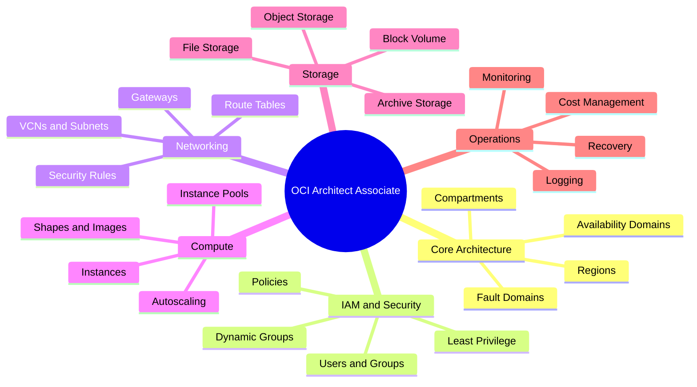
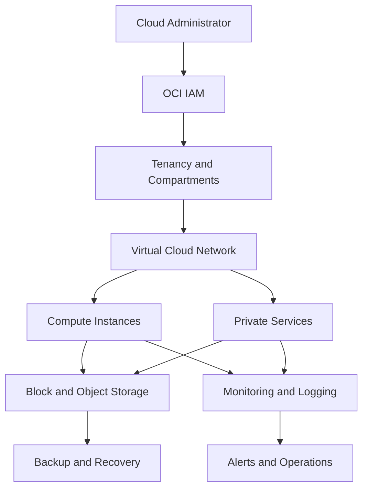
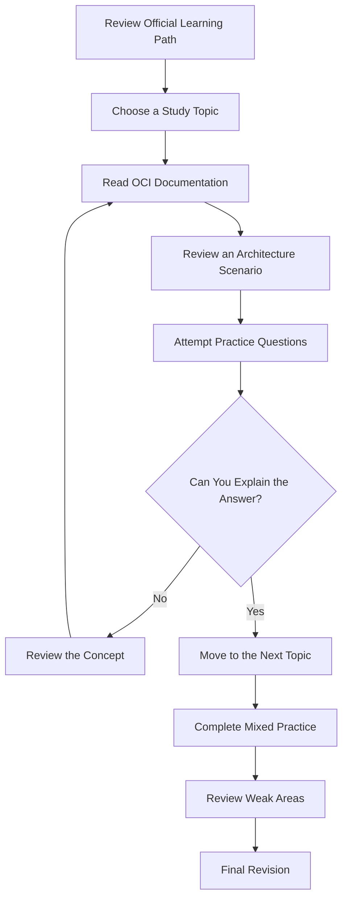
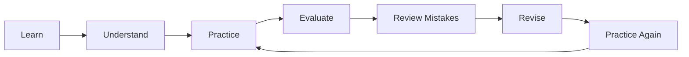

 Oracle 1Z0-1072-26: Cloud Infrastructure 2026 Architect Associate

Preparing for the Oracle Cloud Infrastructure 2026 Architect Associate (1Z0-1072-26)exam? This repository brings together useful study guidance, OCI architecture concepts, networking, compute, storage, security, and practice resources to help you organize your preparation.

Whether you're learning Oracle Cloud Infrastructure for the first time or reviewing your existing cloud knowledge, use this guide to structure your studies and identify areas that need more attention.

Explore additional exam preparation resources:[CertsGate — Oracle 1Z0-1072-26](https://certsgate.com/exams/oracle/1z0-1072-26)

> Note: Always verify the latest exam objectives, requirements, and learning path through Oracle's official resources.

---

 Table of Contents

- [Exam Overview](exam-overview)
- [Who Should Use This Guide?](who-should-use-this-guide)
- [Key Study Areas](key-study-areas)
- [OCI Architecture Mind Map](oci-architecture-mind-map)
- [Conceptual Cloud Architecture](conceptual-cloud-architecture)
- [Exam Preparation Workflow](exam-preparation-workflow)
- [Study Cycle](study-cycle)
- [Four-Week Study Roadmap](#four-week-study-roadmap)
- [Hands-On Practice Checklist](#hands-on-practice-checklist)
- [Practice Questions](#practice-questions)
- [Common Preparation Mistakes](#common-preparation-mistakes)
- [Frequently Asked Questions](#frequently-asked-questions)
- [Official Learning Resources](#official-learning-resources)
- [About CertsGate](#about-certsgate)
- [Disclaimer](#disclaimer)

---

 Exam Overview

The 1Z0-1072-26 exam is associated with the Oracle Cloud Infrastructure 2026 Architect Associate certification.

Oracle Cloud Infrastructure (OCI) provides cloud services for deploying, connecting, securing, managing, and scaling workloads. Architecting solutions requires understanding how infrastructure components work together to meet availability, security, performance, and cost requirements.

| Detail | Information |
|---|---|
| Exam code | 1Z0-1072-26 |
| Exam name | Oracle Cloud Infrastructure 2026 Architect Associate |
| Provider | Oracle |
| Level | Associate |
| Main platform | Oracle Cloud Infrastructure |
| Core focus | Cloud architecture, infrastructure services, security, and operational efficiency |
| Exam duration | 90 minutes, according to Oracle's published learning path |
| Official learning path | [Oracle MyLearn](https://mylearn.oracle.com/ou/learning-path/become-an-oci-architect-associate/162234) |

Check Oracle MyLearn for the latest exam format, registration requirements, and completion conditions.

---

 Who Should Use This Guide?

This repository may be useful for:

- IT professionals learning cloud infrastructure.
- Cloud engineers building OCI knowledge.
- Infrastructure and system administrators.
- Network engineers exploring cloud networking.
- Developers deploying applications on OCI.
- Certification candidates seeking a structured revision plan.

Basic knowledge of networking, compute, storage, identity management, and cloud security can make preparation easier.

If you're new to OCI, start with the core concepts before moving into architecture scenarios involving several services.

---

 Key Study Areas

The following sections provide a practical framework for organizing your revision. Use Oracle's current learning path as the final authority on exam scope.

 1. OCI Core Concepts and Architecture

Learn how OCI organizes infrastructure and supports cloud workloads.

- OCI regions and availability domains.
- Fault domains and failure isolation.
- Tenancies and compartments.
- Cloud resource organization.
- High availability and resilience.
- Shared responsibility and cloud security principles.
- Architecture decisions based on workload requirements.

Study goal: Understand how OCI infrastructure is organized and how architecture choices affect availability and reliability.

 2. Identity and Access Management (IAM)

Review how users, services, and workloads receive appropriate access.

- Users and groups.
- IAM policies and permissions.
- Compartments and resource access.
- Dynamic groups and resource principals.
- Identity federation concepts.
- Least-privilege access.
- Audit and security considerations.

**Study goal:** Be able to reason about which identity and policy design satisfies a requirement without granting unnecessary permissions.

### 3. Networking

Understand how OCI resources communicate securely.

- Virtual Cloud Networks (VCNs).
- Subnets, route tables, and CIDR ranges.
- Security lists and Network Security Groups.
- Internet, NAT, and service gateways.
- Local and remote peering.
- Dynamic Routing Gateway (DRG).
- Public and private IP addresses.
- DNS and load balancing.
- VPN and FastConnect concepts.

Study goal: Explain network traffic paths, required gateways, and the security controls that govern connectivity.

4. Compute Services

Learn how compute resources are selected, deployed, and managed.

- Virtual machine and bare metal instances.
- Compute shapes and resource sizing.
- Images and boot volumes.
- Instance pools and autoscaling.
- High availability considerations.
- Load balancing and application availability.
- Workload placement and scaling decisions.

**Study goal:** Match compute options to workload requirements, capacity needs, and availability expectations.

### 5. Storage Services

Review the main OCI storage options and their use cases.

- Object Storage.
- Block Volume.
- File Storage.
- Archive Storage.
- Storage performance and durability.
- Backup and recovery concepts.
- Data lifecycle and retention.
- Access controls and encryption.

Study goal:Choose an appropriate storage service based on access patterns, performance, durability, and recovery requirements.

6. Databases and Data Workloads

Understand how database services fit into OCI architecture.

- Managed database service concepts.
- Autonomous Database use cases.
- Database connectivity.
- Backup and recovery considerations.
- High availability and disaster recovery.
- Data protection and encryption.
- Workload requirements and service selection.

Study goal: Understand how database choices affect availability, management, and workload design.

7. Security, Monitoring, and Cost Management

Learn how to operate cloud resources responsibly.

- Identity and resource security.
- Encryption and key management.
- Monitoring, metrics, and alarms.
- Logging and audit information.
- Resource tagging and organization.
- Budgets and cost awareness.
- Capacity planning and operational efficiency.

Study goal: Include security, observability, and cost considerations in architecture decisions rather than treating them as afterthoughts.

---
 OCI Architecture Mind Map

Use this map to build your notes. Add a short explanation and one practical example under each branch.

---

Conceptual Cloud Architecture

This diagram illustrates a simplified OCI environment. It is a conceptual learning example, not a mandatory deployment design.

 Architecture concepts to understand

- IAM: Controls who can access resources and what actions they can perform.
- Compartments:Organize resources and support access-control boundaries.
- Networking:Connects workloads and controls traffic paths.
- Compute: Runs applications and services.
- Storage: Holds application data and infrastructure-related information.
- Monitoring: Helps administrators identify problems and understand resource behavior.
- Recovery: Supports continuity and restoration planning.

---

Exam Preparation Workflow

Follow this workflow to turn your study time into a repeatable learning process.

For each scenario, identify the business requirement first. Then consider security, network connectivity, availability, performance, and cost before selecting a solution.

---

Study Cycle

Repeat this cycle for every major topic.

A useful study session should leave you with something concrete: revised notes, a diagram, a lab result, or a clear explanation of an architecture decision.

---

 Four-Week Study Roadmap

This is a suggested timetable, not an official Oracle study schedule. Adjust it according to your experience and available time.

| Week | Focus | Suggested activities |
|---|---|---|
| Week 1 | Core architecture and IAM | Review OCI structure, compartments, users, groups, policies, and security concepts |
| Week 2 | Networking and compute | Study VCNs, routing, gateways, security rules, instances, and scaling |
| Week 3 | Storage and data workloads | Compare storage services and review database, backup, and recovery concepts |
| Week 4 | Operations and revision | Review monitoring, logging, cost considerations, architecture scenarios, and weak areas |

 Suggested daily routine

1. Select one topic from the official learning path.
2. Study the related Oracle documentation.
3. Summarize the concept in your own words.
4. Work through a practical or hypothetical architecture scenario.
5. Attempt practice questions.
6. Review mistakes and revisit unclear concepts.

---

Hands-On Practice Checklist

Where you have access to an authorized OCI tenancy, use practical exercises to strengthen your understanding.

- [ ] Explore OCI regions and availability concepts.
- [ ] Organize resources using compartments.
- [ ] Review users, groups, and IAM policies.
- [ ] Create or review a VCN and subnet configuration.
- [ ] Examine route tables and gateway choices.
- [ ] Compare security lists with Network Security Groups.
- [ ] Review compute shapes and instance configuration.
- [ ] Compare Object, Block, and File Storage.
- [ ] Review database service options for different workloads.
- [ ] Explore monitoring metrics and alarms.
- [ ] Review logging and audit capabilities.
- [ ] Estimate resource costs before deployment.
- [ ] Document an architecture decision and explain why it meets the requirements.

Only create resources when you have authorization. Check pricing, quotas, and permissions first, and remove test resources when finished to avoid unnecessary charges.

---

 Practice Questions

Practice questions can help you identify knowledge gaps and become more comfortable with architecture scenarios.

For each question:

1. Read the scenario carefully.
2. Identify the required outcome.
3. Compare the relevant OCI services.
4. Consider security, connectivity, availability, and cost.
5. Explain why the selected solution fits.
6. Review the relevant documentation if you are unsure.

For additional exam preparation resources, visit [CertsGate — Oracle 1Z0-1072-26](https://certsgate.com/exams/oracle/1z0-1072-26).

 Illustrative practice question

Scenario: An organization needs to give a compute instance access to an OCI service without storing long-lived user credentials inside the application.

Which approach should the architect investigate?

A. Use an appropriate resource principal and dynamic group policy.  
B. Give every user administrator privileges.  
C. Make all application data publicly accessible.  
D. Remove all network security controls.

Answer: A.

Explanation: OCI resource principals and dynamic groups can support authorized access by resources, based on appropriate IAM policies. The exact configuration depends on the service and use case.

*This is an original illustrative learning question, not an official Oracle exam question.*

---

Common Preparation Mistakes

Avoid these common study mistakes:

- Memorizing service names without understanding their use cases.
- Confusing compartments with networking boundaries.
- Overlooking IAM policy scope and least privilege.
- Mixing up the purposes of NAT, internet, and service gateways.
- Ignoring the difference between security lists and Network Security Groups.
- Choosing storage without considering access patterns and performance.
- Ignoring availability and recovery requirements.
- Forgetting cost and monitoring considerations.
- Relying on outdated materials without checking the current learning path.

Focus on explaining why a particular design fits the requirement and what trade-offs it introduces.

---

 Frequently Asked Questions

 What is the 1Z0-1072-26 exam?

It is the Oracle Cloud Infrastructure 2026 Architect Associate exam.

 What topics should I study?

Start with the official Oracle learning path. Key preparation areas include OCI architecture, IAM, networking, compute, storage, security, and operational considerations.

 Is hands-on practice useful?

Yes. Practical exercises help connect individual services to real architecture decisions. If a live tenancy is unavailable, use official learning resources and documented scenarios.

 How long should I prepare?

It depends on your current cloud experience and familiarity with OCI. The four-week roadmap is a suggested structure, not an official preparation requirement.

 Where can I find additional study material?

Start with Oracle MyLearn and official OCI documentation. You can also explore [CertsGate's 1Z0-1072-26 preparation page](https://certsgate.com/exams/oracle/1z0-1072-26).

 Does this guide guarantee a passing result?

No. It is a learning resource, not a guarantee of certification success.

---

 Official Learning Resources

Use Oracle's official resources to verify exam details and understand current service behavior.

- [Oracle MyLearn — OCI Architect Associate Learning Path](https://mylearn.oracle.com/ou/learning-path/become-an-oci-architect-associate/162234)
- [Oracle Cloud Infrastructure Documentation](https://docs.oracle.com/en-us/iaas/Content/home.htm)
- [Oracle Cloud Infrastructure](https://www.oracle.com/cloud/)
- [Oracle Certification and Training](https://education.oracle.com/)

Check the current learning path for the applicable exam version, objectives, completion conditions, and registration details.

---

 About CertsGate

[CertsGate](https://certsgate.com/) offers IT certification preparation resources for learners working toward professional technology certifications.

For this exam, visit the dedicated page:

Oracle Cloud Infrastructure 2026 Architect Associate — 1Z0-1072-26](https://certsgate.com/exams/oracle/1z0-1072-26)

Use additional preparation resources alongside official documentation, practical exercises, and regular revision.
**Learn the concepts, practise architecture scenarios, review your mistakes, and keep your preparation aligned with Oracle's current learning resources.**

